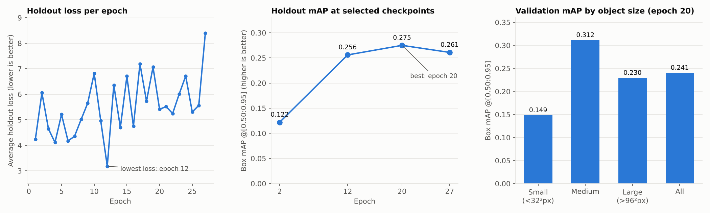

# Aerial Object Detection with a CenterNet-style Detector

An anchor-free object detector for aerial imagery, built from scratch in PyTorch and trained on the [iSAID](https://captain-whu.github.io/iSAID/) dataset. It finds 15 kinds of object (planes, ships, small and large vehicles, storage tanks, harbours, sports courts and more) by predicting a heatmap of object centres plus each object's size, in the style of CenterNet ("Objects as Points"). Every part was written by hand: tiling, training targets, loss functions, training loop, decoding and evaluation.

## Results

Scored with COCO-style box mAP (pycocotools) on the **iSAID validation set** (458 images, cut into 23,225 tiles of 512 × 512), using the best checkpoint from training. The model was trained **from scratch**, with no pretrained backbone.

| Metric (iSAID val, 512 × 512 tiles) | Score |
|---|---|
| **mAP @ IoU 0.50:0.95** | **0.241** |
| AP @ IoU 0.50 | 0.413 |
| AP @ IoU 0.75 | 0.255 |
| AP small / medium / large objects | 0.149 / 0.312 / 0.230 |
| Average recall (up to 100 boxes per tile) | 0.392 |



- **Medium-sized objects are found best** (0.312). **Small objects are hardest** (0.149): mostly small vehicles only a few pixels across, often packed tightly together.
- **The model generalises.** The best checkpoint scored 0.275 mAP on my holdout set and 0.241 on the official validation images, which it never saw during training or checkpoint selection.
- These scores are measured on 512 × 512 tiles rather than full images, and without a pretrained backbone, so they are not directly comparable to published iSAID leaderboard results.

## What's in this project

- **Tiling pipeline:** iSAID images are up to several thousand pixels across, so each one is cut into overlapping 512 × 512 tiles (stride 384). Boxes are shifted into each tile's coordinates and clipped at the edges, and a box is kept only if at least half of it survives the crop. The result is about 890,000 boxes across train, holdout and validation.
- **Leakage-free splits:** the official training images are split 90/10 into train and holdout **by source image, not by tile** (fixed seed), so overlapping tiles from one image never end up on both sides. Holdout and validation keep empty tiles, so false alarms on empty ground are counted honestly.
- **CenterNet targets from scratch:** for each tile, a 15-channel heatmap with a Gaussian blob at each object's centre, plus width/height and sub-pixel offset maps, all on a 128 × 128 grid (stride 4).
- **Detector network:** a U-Net-style encoder-decoder (30.8M parameters) with three output heads: centre heatmap, box size and centre offset. The two widest decoder blocks run in float32 under mixed precision, to avoid a float16 overflow I found in an [earlier U-Net project](https://github.com/Idris903/Geomodel).
- **Loss functions written by hand:** CenterNet's penalty-reduced focal loss for the heatmap, and a masked L1 loss for size and offset, combined as `heatmap + 0.1 × size + 1 × offset`. Each was checked against values I worked out by hand (notebook 07).
- **Training:** mixed precision (`torch.autocast` + `GradScaler`), AdamW, batch size 8, a holdout check after every epoch, and a checkpoint saved every epoch. Run in tmux on an AWS GPU instance (NVIDIA L4, about 25 minutes per epoch).
- **Decoding:** a 3 × 3 max-pool keeps only local peaks in the heatmap (so one object gives one box), then the top-K peaks across all classes are turned back into class, position, size and finally pixel boxes in COCO `[x, y, w, h]` format, batched on the GPU.
- **Evaluation:** every predicted box is matched to its tile with a tile ID carried through the Dataset, then scored with pycocotools' `COCOeval`.

## Debugging stories

**1. The loss pointed at the wrong checkpoint.** The holdout loss was lowest at epoch 12 and then drifted upwards while the training loss kept falling, which looked like overfitting. But scoring checkpoints with mAP told a different story: epochs 2, 12, 20 and 27 scored 0.122, 0.256, **0.275** and 0.261. The model kept getting better at finding real objects until about epoch 20. The likely cause is that the **training set had no empty tiles** while the holdout set has many. As the model grew more confident, it made confident false alarms on empty tiles, which the focal loss punishes heavily even though they barely affect mAP. So I chose the final checkpoint by mAP instead of loss.

**2. Validation mAP of exactly 0.000.** The first validation run scored 0.000, even though the same checkpoint scored 0.275 on holdout. A model doesn't collapse like that between two similar image sets, so I looked for a mismatch instead. It turned out **iSAID's train and validation annotation files number the 15 classes differently**: the model learned "small vehicle = 3", but in the validation file 3 means "baseball diamond". Mapping each predicted class to the validation file's numbering **by class name** fixed it, and the score went from 0.000 to 0.241.

**3. A 10,000× loss on empty tiles.** While testing the focal loss on hand-made examples, a tile with no objects gave a loss of about 68,900 instead of about 6.9. The loss divides by the number of objects plus 0.0001 (to avoid dividing by zero), and on an empty tile that means dividing by 0.0001, i.e. multiplying by 10,000. Clamping the object count to a minimum of 1 fixed it.

## How to run

You'll need the iSAID annotations and the DOTA v1.0 images (not included here, as they are released for non-commercial research use), a CUDA GPU, PyTorch, torchvision, NumPy, Pillow, tqdm and pycocotools.

1. Put the data under `~/data/isaid/{train,val}/` with `images/` and `Annotations/iSAID_*.json` in each.
2. Make the tiles (writes to `~/data/tiles/{train,holdout,val}/`):
   ```
   python scripts/make_tiles.py
   ```
3. Train (saves a checkpoint per epoch to `~/checkpoint/`):
   ```
   python scripts/train.py
   ```
4. Evaluate with pycocotools (the split and checkpoint are set near the top of the script):
   ```
   python scripts/evaluate.py
   ```

Long runs are best started inside `tmux`, so they keep going if the SSH connection drops.

## Project structure

```
├── src/
│   ├── tiling.py      # cutting images into tiles and moving boxes into tile coordinates
│   ├── targets.py     # CenterNet heatmap, size, offset and mask targets
│   ├── dataset.py     # PyTorch Dataset: tile image + targets + tile ID
│   ├── model.py       # the detector network
│   ├── loss.py        # focal loss and masked L1 loss
│   └── decoder.py     # heatmap peaks → top-K → boxes
├── scripts/
│   ├── make_tiles.py  # builds the train / holdout / val tiles
│   ├── train.py       # training loop with holdout check and checkpoints
│   └── evaluate.py    # decoding + COCO mAP with pycocotools
├── notebooks/         # step-by-step tests for each part (01 model … 08 decoder)
└── assets/            # README figures
```

## Next steps

- **A second training run** with the fixes this one pointed to: some empty tiles in training, a learning-rate schedule, dropping the leftover one-tile batch, and a training-loss average per epoch.
- **Faster data loading:** a vectorised Gaussian in the target builder and more DataLoader workers, so faster GPUs aren't left waiting on the CPU.
- **Small objects:** more boxes kept per tile (iSAID tiles can hold hundreds of vehicles, and only the top 100 are scored) and better handling of objects whose centres share a grid cell.
- **A mask head** to turn detection into instance segmentation, and a comparison against a pretrained backbone.

## Dataset and references

- iSAID: 15 object classes across 2,806 aerial images (1,411 train, 458 val, 937 test), with images from DOTA v1.0. I downloaded them from the Hugging Face datasets `isaaccorley/isaid` and `isaaccorley/dota`.
- Zamir et al., "iSAID: A Large-scale Dataset for Instance Segmentation in Aerial Images", CVPR Workshops 2019
- Zhou et al., "Objects as Points" (CenterNet), 2019

## Tech

Python, PyTorch, NumPy, Pillow, pycocotools, tqdm, Matplotlib, AWS EC2 (NVIDIA T4 and L4 GPUs), tmux, Git

Built as a learning project, with AI assistance for guidance and code review.
